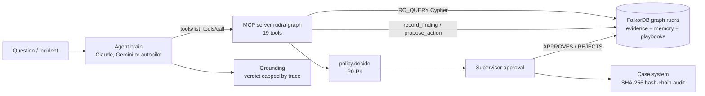
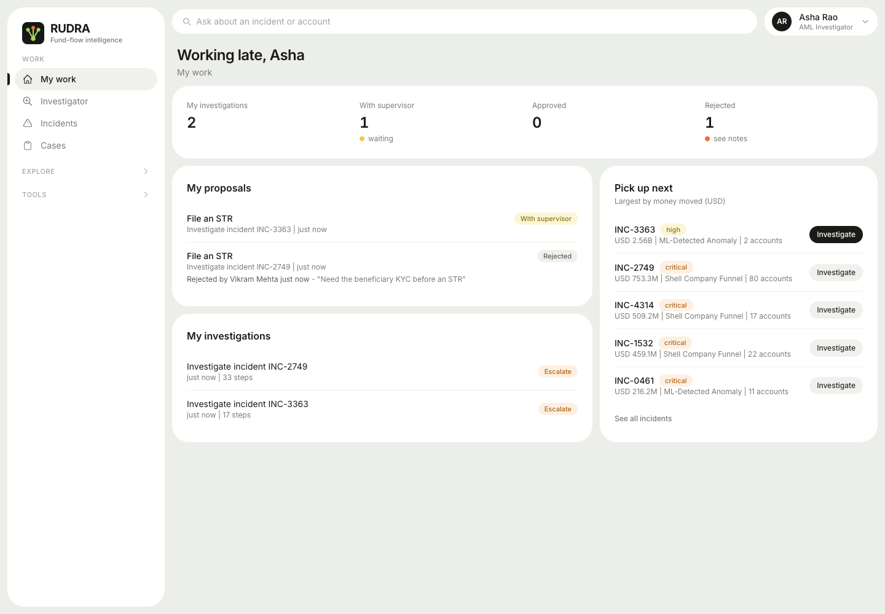
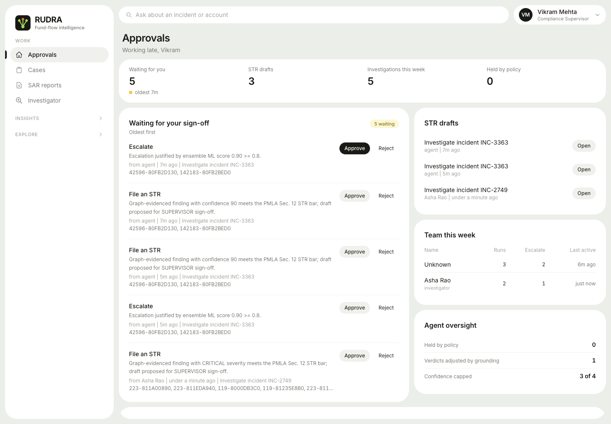
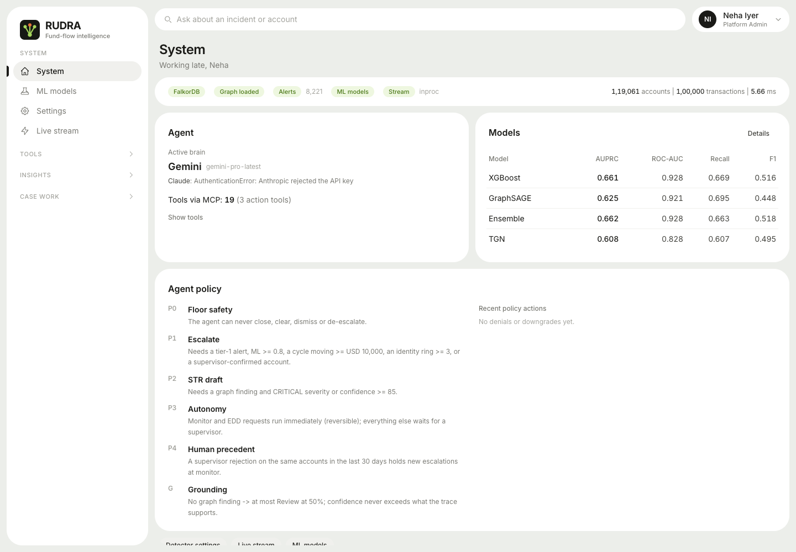

# Follow the Money, Cite the Edge: an AML Agent That May Escalate but Never Close


*RUDRA Investigator, our entry to Graph Hacks: Context for AI Agents (WeMakeDevs x FalkorDB), Track 01: Agents That Act on Connected Data.*

## An alert is where the work starts

Anti-money-laundering software is good at raising its hand. RUDRA, the system this project grew out of, already did that: rule detectors for cycles, layering, smurfing and funnel accounts, plus an XGBoost / GraphSAGE / stacked-ensemble scorer trained on the IBM AML benchmark. On our 100,000-transaction sample it produces 8,221 alerts, clustered into 4,334 incidents.

That is the easy half. An alert is the start of an investigation, not the end of one. A human analyst then spends hours doing the same handful of things: open the account, see where the money went next, check whether it came back, look for who else shares a phone or a KYC document, ask whether anyone on the team has already looked at these people, and finally write something a supervisor and a regulator will accept. Every one of those steps is a hop across connected data, and every conclusion has to point at specific transactions.

So we built an investigator agent for that second half, and we made one decision early that shaped everything after it: the agent's context is not a prompt stuffed with retrieved rows. Its context is a FalkorDB graph that holds both the evidence and the agent's own memory.

A note on honesty before going further. RUDRA's detectors, ML models and case system existed before this hackathon; we reused them as infrastructure. The FalkorDB graph, the MCP server, the agent, the policy gate, verdict grounding, the memory layer and the three-role UI were built between October 15 and 18, 2026. That is the part this post is about.

## Why the graph is the context, not a sidecar

Here are the questions an investigator actually asks, and why none of them is a lookup:

| Question | What it is in graph terms | MCP tool |
|---|---|---|
| Where did *this* money go next? | multi-hop path, each hop later in time, amount roughly preserved | `trace_funds` |
| Does it come back to where it started? | directed cycle through the account | `find_cycles` |
| Who shares a device, IP or KYC document? | transitive closure over identity edges | `shared_identifier_ring` |
| Who coordinates this neighbourhood? | PageRank over transfers | `pagerank_hubs` |
| Closed ring or open economy? | label-propagation community + flagged density | `community_of` |
| Has a human already decided about these people? | traversal account -> finding -> decision -> review | `find_precedents` |
| What is the procedure for this typology? | a Playbook node | `get_playbook` |

A vector store can find text that sounds like "layering". It cannot tell you where the same money went next, in time order. That needs a traversal whose shape is the evidence.

The second reason is memory. If the agent's notes lived in a separate store, "has anyone looked at this before?" would be a join across two systems. Because Investigations, Findings and Decisions are nodes in the same graph as the accounts, a precedent is just a longer path.

### The schema

```
EVIDENCE                                         MEMORY (written by the agent and by humans)
(:Account)-[:TXN {tid, ts, amount, currency,     (:Investigation)-[:ABOUT]->(:Account)
   amount_usd, rail, is_fraud, ml_score}]->      (:Investigation)-[:STEP {n}]->(:ToolCall {tool, cypher, rows, ms})
   (:Account)                                    (:Investigation)-[:FOUND]->(:Finding {claim, provenance, evidence_tids})
(:Alert {tier, ml_score})-[:FLAGS]->(:Account)   (:Finding)-[:SUPPORTED_BY]->(:Account)
(:Incident)-[:CONTAINS]->(:Alert)                (:Decision)-[:CAUSED_BY]->(:Finding)
(:Account)-[:USES]->(:Device)                    (:Decision {actor:'human'})-[:APPROVES|REJECTS]->(:Decision)
(:Account)-[:FROM_IP]->(:IP)                     (:Decision)-[:PRECEDENT_FOR]->(:Investigation)
(:Account)-[:HAS_KYC]->(:KYC)                    (:Account)-[:ON_WATCHLIST]->(:Watchlist)

PROCEDURE
(:Playbook {typology, tool_sequence, legal_basis})
```

The graph `rudra` holds 119,061 accounts and 100,000 `TXN` edges: one edge per transaction. RUDRA's original NetworkX graph aggregated each sender/receiver pair into a single edge, which is fine for scoring and useless for "what happened next", so FalkorDB holds the full multigraph with per-transaction timestamps. The identity lane (device / IP / KYC) is RUDRA's synthetic identity dataset, because IBM AML has no such fields; it is labelled synthetic everywhere it appears. Loading takes about 16 seconds and the graph uses 76 MB.

Graph analytics stay inside the database: `algo.pageRank`, `algo.WCC` and `algo.labelPropagation` run in FalkorDB and are written back onto every account as properties (about 4.5 s for 119k accounts).

## How the agent works



The agent does not have its tools hard-coded. It spawns the MCP server `rudra-graph`, calls `tools/list`, and gets 19 tools: lookups, traversals, algorithms, a guarded read-only Cypher escape hatch, and three action tools (`record_finding`, `propose_action`, `draft_str`). The same server works from any MCP client; `claude mcp add rudra-graph -- scripts/run_mcp_server.sh` is all it takes.

Every read tool returns an envelope: `{tool, data, cypher, params, rows, ms, provenance, metrics}`. The exact Cypher and FalkorDB's own timing travel with the evidence, and each call is persisted as a `(:ToolCall)` on the investigation. When a regulator asks "how did you get this?", the answer is a query you can re-run.

### The playbook opens, the graph steers

A typical run: `get_incident`, then `get_playbook` for the incident's typology. The Playbook node is procedural memory: an ordered tool sequence and a legal basis per FATF typology. After the opening, the agent follows what the results say.

The core traversal is the temporal-causal money trace. A plain `-[:TXN*1..4]->` finds paths that exist; it does not find the *same money moving*. This is the real query from `src/graphdb/queries.py` (forward direction):

```cypher
MATCH p = (a:Account {id: $id})-[:TXN*1..4]->(x:Account)
WHERE x <> a AND all(r IN relationships(p) WHERE r.amount_usd >= $min_amount)
WITH p, relationships(p) AS rs, nodes(p) AS ns
WHERE all(i IN range(0, size(rs) - 2) WHERE
        rs[i+1].ts > rs[i].ts AND rs[i+1].ts - rs[i].ts <= $window_s
        AND rs[i+1].amount_usd >= rs[i].amount_usd * $keep_lo
        AND rs[i+1].amount_usd <= rs[i].amount_usd * $keep_hi)
```

Each hop must happen after the previous one, within a window (72 hours by default), and carry forward 50 to 110 percent of the previous amount. A uniqueness check drops paths that revisit an account, and the result lists every hop's `tid`. On the full 100k graph this runs in about 47 ms.

Cycles look like this:

```cypher
MATCH p = (a:Account {id: $id})-[:TXN*1..5]->(x:Account)-[:TXN]->(a)
```

That odd shape, with the last hop written out separately, is a FalkorDB lesson we will come back to. A temporal clause on top accepts any rotation of the loop that is time-ordered, so a round trip is found whichever account the investigation enters it from. Typical time: about 33 ms. Other measured timings: `account_profile` about 6 ms, 2-hop neighbourhood about 45 ms, live PageRank about 59 ms, identity ring about 4 ms.

### Findings are pinned to transaction ids

The agent records claims with `record_finding`, and each one carries a provenance (GRAPH, ML, RULE, PRECEDENT, INFERRED) and the transaction ids it relies on. The tool checks every cited `tid` against the graph and reports which ones do not exist. The finding becomes a node, linked to the accounts it is about. A claim with no edges behind it is visible as exactly that.

### Three brains, one trace

The brain is swappable: Claude, Gemini (`gemini-pro-latest` via `google-genai`), or a no-LLM autopilot. All three call the same tools and write the same trace.

The autopilot matters more than it looks. It is not a script. The playbook sets the opening moves; after that, results *nominate* accounts: cycle partners, where traced money lands, the most central account nearby, flagged neighbours. Each nominee is profiled and must pass a relevance gate (alerts, ML >= 0.5, or an IBM laundering label) before budget is spent, with a cap of 4 accounts per investigation. Each choice is narrated in the trace. If an agent with no language model at all can run a sensible investigation purely from what the graph returns, the graph is doing the steering. In compliance, a deterministic fallback that behaves the same way every time is also simply useful.

## It acts, within rules

Track 01 asks for agents that act. In AML, an agent that acts freely is a liability, so we split it: the model proposes, a deterministic policy (`src/agent/policy.py`, pure Python, no DB, no LLM) decides what the proposal becomes, and the evidence it decides on is read back out of the graph, not taken from the model's description.

- **P0 floor safety.** close, clear, dismiss and de-escalate are always denied. The agent may *recommend* clearing; only a supervisor can do it.
- **P1 escalate basis.** Escalation needs one of: a tier-1 alert (ML and rules agree), ensemble ML >= 0.8, a closed cycle moving >= USD 10,000, a shared-identifier ring of >= 3 accounts, or an account a supervisor previously confirmed suspicious. Otherwise it is downgraded to `open_case`.
- **P2 STR bar.** Drafting a Suspicious Transaction Report needs a GRAPH-provenance finding plus CRITICAL severity or confidence >= 85. Otherwise it drops to escalate and is re-checked under P1.
- **P3 tiered autonomy.** `monitor` and `request_edd` are reversible, so the agent executes them itself: the accounts get an `ON_WATCHLIST` edge recording the investigation, decision and reason. Everything else waits for a supervisor.
- **P4 human precedent.** If a supervisor rejected a decision on the same accounts within 30 days, a new escalation is held at `monitor`. That rejection lives in the graph, and the next investigation finds it by traversal.

Then a second gate, grounding (`src/agent/grounding.py`), caps the verdict by what the trace contains. No GRAPH finding means the verdict is at most REVIEW at 50 percent confidence. ESCALATE needs graph evidence and a policy-endorsed escalation. Confidence is the minimum of the model's claim and an evidence-derived cap, and cited ids that do not exist cut it further. The model can say whatever it likes; the recorded verdict cannot exceed what the graph supports.

### Three people, three screens

Approval is a human act, on a different person's screen. The UI has three roles with different homes.

Asha, the investigator, lands on **My work**: her runs and what happened to each proposal.



Vikram, the supervisor, lands on **Approvals**: a sign-off queue showing who sent each item and how long it has waited. He can approve, or reject with a reason.



Neha, the admin, lands on **System**: health, the active brain, the 19 MCP tools, the model table (AUPRC: XGBoost 0.661, GraphSAGE 0.625, ensemble 0.662, TGN 0.608) and a log of every time the policy held the agent back.



An approval bridges into RUDRA's existing case system, whose audit log is a SHA-256 hash chain, so editing history after the fact is detectable. The human review is also written back into the graph as a `Decision {actor:'human'}` with an `APPROVES` or `REJECTS` edge, which is how it becomes precedent for the next run.

## The removal test

The track's rule is that the graph has to shape what the agent does. The cleanest way we found to check that is to take the graph away and watch.

With `graph_tools: false` (a toggle in the UI), the agent keeps only flat lookups: incident, account profile, alert search. No traces, no cycles, no rings, no playbook, no memory.

With Gemini Flash and the graph off, the model confidently claimed ESCALATE at 0.95. It had nothing to back that with, and grounding cut it to REVIEW at 0.5. With the graph on, the same model on the same question produced 6 graph findings citing 14 verified transaction ids. The policy behaves the same way: without a GRAPH finding there is no STR.

A live run with Gemini Pro on INC-2749 ended at ESCALATE, with confidence grounded from 0.95 to 0.83, USD figures, and cited tids. The model asked for more certainty than the trace supported, and the trace won.

## What broke, and what we learned

**We added fifteen currencies together.** The IBM data mixes 15 currencies, and an early version summed raw `amount` across them, so a ruble transfer and a dollar transfer counted the same. Totals, the cycle threshold, everything downstream was wrong in a way that looked plausible. The fix is a fixed, approximate September 2022 FX table (`src/graphdb/fx.py`, deliberately not live, so results are reproducible) and an `amount_usd` property on every `TXN` edge, with the native amount and currency kept alongside. The fun aftershock: INC-3363 shows USD 2.56B moved. We assumed a bug. It is a real 2.49B CHF transfer in the dataset.

**The agent cited itself.** `find_precedents` returned earlier investigations touching the same accounts, and the agent happily treated its own earlier, unreviewed proposals as "precedent", which is circular reasoning with extra steps. Now only human-reviewed decisions count as evidence; an agent proposal nobody has looked at is history, not authority.

**A small model invented a schema.** Gemini Flash once used `run_cypher_readonly` with labels that do not exist, recorded no findings, and submitted the word "test" as its summary. Four fixes came out of that one run: schema validation in `run_cypher_readonly` (unknown labels, relationship types and property keys are reported back instead of silently returning nothing); a verdict quality gate that sends a bad verdict back once (no findings recorded, or a summary under eight words); findings auto-recorded from tool output; and the grounding cap above.

**FalkorDB Cypher has its own grain.** None of these are complaints, just things worth knowing:

- Variable-length hop bounds must be literals. We clamp to small integers and format them in; user text never reaches the query string.
- A path that closes on its own start node, `(a)-[*]->(a)`, reported `nodes(p)` in reversed order relative to `relationships(p)` in our tests. Writing the closing hop separately, `(a)-[*1..n]->(x)-[:TXN]->(a)`, keeps both lists in traversal order.
- After `SET` or `FOREACH` you need a `WITH` before the next `MATCH`.
- Edge-index lookups want unlabelled endpoints. `MATCH ()-[t:TXN]->() WHERE t.tid IN $tids` uses an edge index scan (about 4 ms); labelling both ends as `:Account` made the planner scan all 119k accounts first and time out. Endpoints are read with `startNode(t)` and `endNode(t)`.
- Every read tool goes through `GRAPH.RO_QUERY` with a per-query timeout. A timeout comes back to the agent as `timed_out: true` with advice to narrow the query, instead of an exception that ends the run.

## Try it

- Code: https://github.com/VedantMoghe16/InnovAstra_Falkor
- Live demo: LIVE_DEMO_URL
- Video: VIDEO_URL

```bash
docker run -d -p 6379:6379 -p 3000:3000 falkordb/falkordb:latest
python src/run_pipeline.py          # RUDRA artefacts, once
scripts/load_falkor.sh              # build the context graph
cd backend && uvicorn main:app --port 8000
cd frontend && npm run dev          # sign in as Asha, then Investigator
```

No API key is required: without one, the graph-driven autopilot runs. Open the FalkorDB Browser on port 3000 and run `MATCH (i:Investigation)-[r]->(x) RETURN i,r,x LIMIT 50` to see the decision trace as a graph.

## What is next

- **One graph per institution.** Banks will not share a graph, so multi-tenancy means a FalkorDB graph per bank with the same MCP server in front.
- **Time-valid findings.** A finding true in September may not be true in December. Findings should carry validity intervals and expire, Graphiti-style.
- **Counterfactual checks.** "Which minimal set of edges, if removed, would flip this verdict?" is a graph question, and probably the most honest explanation an agent can give.

The one-line version of what we learned: once the evidence and the agent's memory live in the same graph, the hard parts of building a trustworthy agent (citing evidence, honouring past human decisions, refusing to overclaim) turn into traversals you can test.
